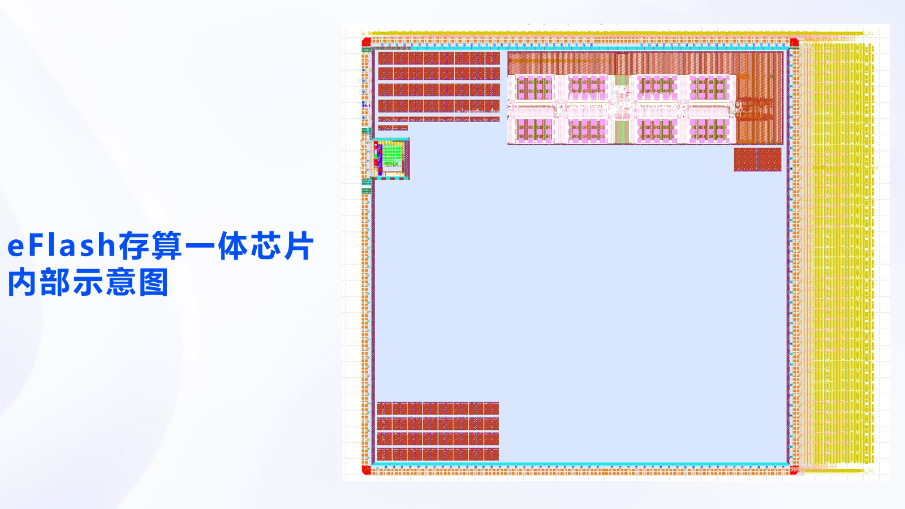
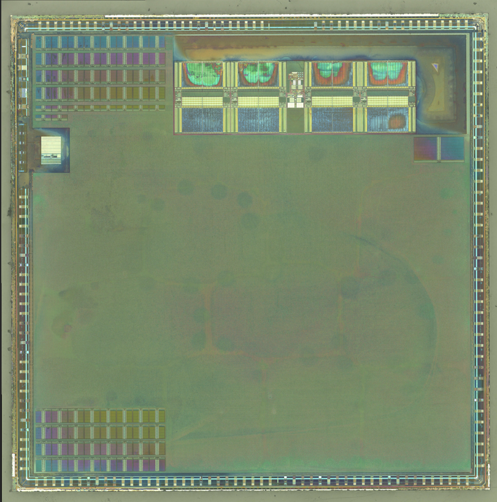
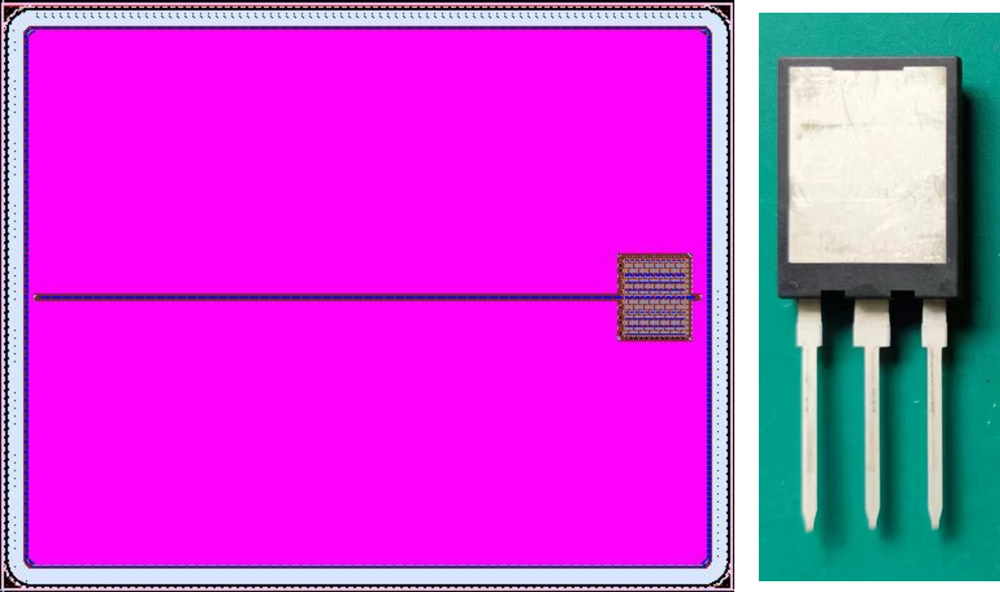
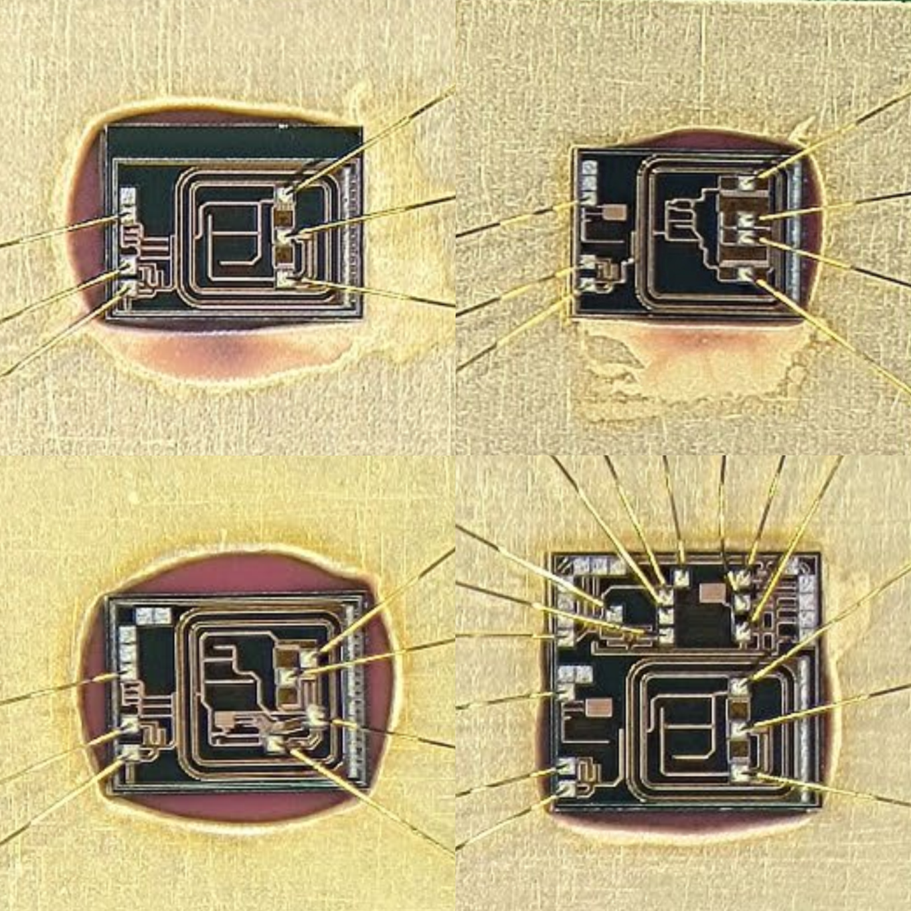

<!-- _class: lead -->
<!-- _header: '' -->
<!-- _footer: '' -->

# 测试导论、缺陷与故障建模

## 从制造不确定性到可计算、可评价的测试对象

3 × 45 分钟理论课堂 · [1] 第 1 章章节结构 · 历史工艺数据仅作理论语境

理论依据：[1] 第 1 章 §1.1–§1.6。

<!--
本页建立全章中心矛盾：制造缺陷不可避免，而测试只能通过有限的外部激励和响应间接判断芯片。后续三节分别回答“为什么测”“怎样建模”“怎样生成与评价”。
-->

---

# 一条问题链贯穿三个 45 分钟节次

<h3>01 · 质量与成本</h3>
测试生命周期、成品率、拒收率、缺陷等级与 ATE 通路

<h3>02 · 缺陷到模型</h3>
缺陷—故障—错误—失效，以及数字、存储器和模拟故障模型

<h3>03 · 生成与评价</h3>
ATPG、故障模拟、覆盖率、测试时间与经济学闭环

<h3>中心问题</h3>
一个有限的测试向量集，凭什么代表大量不可直接观察的制造缺陷？

全章主线物理缺陷 → 抽象故障 → 可观察错误 → 系统失效

学时口径：3 × 45 分钟（评审估计）；节次连续，全程围绕理论推导与结构分析。

<!--
说明三个节次不是三个并列专题。第一节给出经济目标，第二节构造计算对象，第三节把对象、算法和成本连成评价闭环。时间口径是课程设计值，不是实测讲授时长。
-->

---

<!-- _class: divider -->
<!-- _header: '' -->

# 第 1 节

## 测试为什么必须贯穿产品生命周期

45 分钟（评审估计）· 质量、成品率、拒收率与测试成本

<!--
进入质量问题。先不讨论具体故障模型，只回答测试在不同阶段降低什么风险，以及“通过测试”为什么不等于“绝对无缺陷”。
-->

---

# 测试发生在设计、制造与运行的全部阶段

设计验证

晶圆测试

封装/终测

板级/系统

现场运行

<h3>设计阶段</h3>
验证综合后的实现是否满足规格，发现设计错误而非制造缺陷。

<h3>制造阶段</h3>
晶圆探针、封装后终测、参数与压力测试，筛除制造异常。

<h3>运行阶段</h3>
在线或离线检测老化、软错误和现场故障，并支持诊断修复。

设计验证问“是否按意图工作”，生产测试问“具体器件是否受制造缺陷影响”；现场测试关注可靠性。

依据：[1] §1.2（印刷页 2–8）。

<!--
强调测试是生命周期活动。设计验证预测设计是否符合意图；制造测试判断具体器件是否受制造缺陷影响；现场测试关注可靠性、可用性和维修。
-->

---

<!-- _class: dense -->

# 个人流片案例一：55 nm eFlash 存算一体 AI 芯片从版图走向量产筛选

授课教师个人流片经验 素材：[2]。原始材料未给出具体功能、参数、良率实测条件。

<figure>

<figcaption>版图：存储阵列、计算阵列与外围接口的空间分区。</figcaption>
</figure>
<figure>

<figcaption>裸片：从设计数据到可被探针和封装测试的具体器件。</figcaption>
</figure>

功能测试 AI/eFlash 通路

参数测试 电压/电流/时序

晶圆/终测 筛选坏片

量产统计 成品率与分布

失效分析 定位缺陷机理

<strong>待核验：</strong>存储读写/保持、计算功能、功耗速度、良率统计和失效定位的实际测试方案与数据；不能由版图或裸片照片推断这些指标已经通过。

<!--
这是授课教师个人流片经验，不是第三方产品评测。两张图分别证明物理版图和流片后的裸片存在；功能和良率结论仍需要测试程序、测试条件、样本和统计证据。该链从版图/流片进入功能、参数、量产筛选、良率和失效分析，后续第二节再把具体缺陷映射为故障模型。
-->

---

<!-- _class: dense -->

# 个人流片案例二：IGBT 必须把连续参数与热工况纳入判据

授课教师个人流片经验2024-2 素材：[3]。

<figure>

<figcaption>IGBT 裸片版图与封装后的功率器件。</figcaption>
</figure>
<figure>

<figcaption>0.5 µm 700 V BCD 工艺的定制栅极驱动器。</figcaption>
</figure>

<table>
<tr><th>对象</th><th>关键参量</th><th>测试与失效含义</th></tr>
<tr><td>静态/阻断</td><td>V(BR)CES、VCE(on)、VGEth</td><td>耐压、导通损耗和栅极开启边界；必须绑定温度与电流条件。</td></tr>
<tr><td>动态</td><td>td(on)+tr、td(off)+tf、Eon/Eoff</td><td>开关速度与能量损耗受栅阻、负载和母线条件影响。</td></tr>
<tr><td>电容</td><td>Ciss=CGE+CGC；Coss=CCE+CGC；Crss=CGC</td><td>影响驱动电荷、开关速度和米勒耦合。</td></tr>
<tr><td>热/可靠性与工况</td><td>温升、功率/温度循环、短路/SOA；母线电压、负载电流、温度、开关频率</td><td>结温、封装热阻和应用工况共同决定参数漂移与寿命风险；具体条件待核验。</td></tr>
</table>

个人材料记录目标为 1200 V/50 A，并记录某次流片最高 1400 V、最大 70 A；测试条件、样本和统计口径未给出，只能视为单次个人经验，绝非通用规格或产品保证。

<!--
本页只使用教师个人流片材料能够支持的表述。1200 V/50 A 是设计目标；1400 V/70 A 是材料记录的单次结果，不能外推为系列保证。IGBT 的关键不只是通断，还包括条件化的耐压、通态压降、开关能量、电容和热循环可靠性。应用工况包括牵引/工业变换器中的高压、大电流、温度循环与负载变化，具体值待核验。
-->

---

<!-- _class: dense -->

# 两类器件的判据不同，但“缺陷→故障→判据”骨架相同

<table>
<tr><th>比较项</th><th>数字/AI 芯片：eFlash 存算一体</th><th>模拟/功率器件：IGBT + 驱动器</th></tr>
<tr><td>主要物理对象</td><td>逻辑网络、eFlash 阵列、互连、时钟与计算数据通路</td><td>连续电压/电流、载流子输运、结温、封装热路径与栅极驱动</td></tr>
<tr><td>典型缺陷</td><td>开路、桥接、固定型、延迟、串扰、存储保持/耦合异常</td><td>耐压不足、通态压降漂移、开关能量异常、电容偏移、热退化</td></tr>
<tr><td>可观察量</td><td>数字响应、时序、电流、存储内容与覆盖率</td><td>I-V/C-V 曲线、开关波形、损耗、温升与可靠性循环</td></tr>
<tr><td>测试判据</td><td>Rmeas(T)=Rgolden(T)，并满足时间和故障覆盖</td><td>Lj(Θ) ≤ mj ≤ Uj(Θ)，Θ 含温度、电流、栅阻、负载</td></tr>
<tr><td>主要风险</td><td>逻辑逃逸、时序失效、存储保持与控制错误</td><td>参数边界漂移、热失效、过测试和测试条件外推</td></tr>
</table>

统一因果链物理缺陷 <b>→</b> 故障模型 <b>→</b> 可观察差异 <b>→</b> 条件化测试判据 <b>→</b> 良率/可靠性结论

数字芯片强调离散响应和时序覆盖；模拟/功率器件强调参数包络、工况与热可靠性。两者都必须说明模型遗漏了什么。

案例来源：授课教师个人流片材料；未给出的测试条件、样本和统计结果均待核验。

<!--
对比表把两个案例接回全章骨架。数字对象便于用固定型和逻辑差异表达，但不是所有缺陷都能这样表达；模拟/功率对象以连续参数和条件化包络为主，也不能用单一“合格”值代替温度、电流和负载下的行为。'
-->

---

# 成品率描述“造出来有多少可用”，拒收率描述“放出去有多少漏坏”

成品率Y = 合格器件数 / 制造器件总数

<h3>灾难性成品率损失</h3>

随机颗粒、断线、短路等使器件完全失效，常与局部缺陷密度相关。

<h3>参数性成品率损失</h3>

工艺波动使速度、漏电或阈值超出规格，器件可能仍具备部分功能。

质量口径拒收率或缺陷等级 D = 通过终测的器件中仍含故障的比例

成品率是制造结果，缺陷等级是测试筛查后仍逃逸的质量；二者不能互相替代。

依据：[1] §1.2.1.2（印刷页 5–6）。

<!--
区分 yield 和 defect level。前者从未测试的总体出发，后者从已经通过测试的总体出发。测试质量高，不代表制造成品率高。
-->

---

# 成品率与覆盖率共同决定逃逸缺陷等级

Williams 关系D = 1 − Y1−C

<h3>变量含义</h3>
<ul>
<li><b>Y</b>：器件制造成品率</li>
<li><b>C</b>：目标故障模型下的故障覆盖率</li>
<li><b>D</b>：通过测试的器件中仍为坏品的比例</li>
</ul>

<h3>推导直觉</h3>

若每个缺陷被测试发现的概率为 C，则制造良品率必须“折算”为剩余缺陷概率。

ln(1−D) = (1−C) ln Y

该式依赖缺陷与覆盖率模型假设；它给出趋势和数量级，不是对所有缺陷类型的精确承诺。

依据：[1] §1.3.1、式（1.1）附近（印刷页 10–11）。

<!--
由 1-C 的指数关系说明：低覆盖率会把高成品率带来的优势迅速放大成逃逸风险。强调模型假设，避免把公式表述为实测保证。
-->

---

# 完整例题：成品率 92%、覆盖率 96% 时的逃逸质量

<h3>单芯片缺陷等级</h3>

D = 1 − 0.921−0.96

D = 1 − exp(0.04 ln 0.92) ≈ 0.00333

即约 <b>3330 PPM</b>，表示终测通过品中仍可能有约 0.333% 的坏品。

<h3>四十芯片组件的逃逸概率</h3>

1 − (1−D)40 ≈ 12.49%

若各芯片独立且无后续筛查，组件级仍有约八分之一概率遇到至少一个逃逸坏品。

思考：把覆盖率从 96% 提高到 99%，逃逸概率会按 3 倍还是远大于 3 倍的速度下降？

例题采用独立同分布假设，用于展示公式敏感性，不代表特定产品的现场失效率。

<!--
完整代入并解释 PPM 与组件概率。四十芯片的结果是独立近似；真实系统还受相关性、板级测试和现场筛查影响。口头发问引向高覆盖率的经济价值。
-->

---

# ATE 是“计算、波形、测量、判定”的联合系统

<strong>Pattern</strong><h3>图形与数据</h3>
把逻辑向量翻译成引脚边沿、时序格式和测试程序。

<strong>Pin</strong><h3>引脚电子</h3>
驱动器施加电平，比较器采样响应，负载与切换网络建立负载条件。

<strong>Measure</strong><h3>DC/AC 测量</h3>
电压、电流、频率、边沿与抖动等参数由精密测量通路获得。

测试程序的基本映射逻辑向量 + 边沿集 + 电平/时序约束 <b>→</b> 引脚波形 <b>→</b> 输出判定

ATE 的成本核心不只在计算，还包括高速引脚通道、精密测量、夹具、程序开发与机台时间。

依据：[1] §1.5.1（印刷页 25–27）；书中的引脚数和频率属于 2006 年前后的历史语境。

<!--
按数据生成、引脚电子、测试程序、DSP 和 DC/AC 测量解释 ATE。不要把历史引脚数和频率当作当前设备规格。重点是测试成本由完整信号通路产生。
-->

---

# 测试经济学要把一次判定拆成时间、设备与质量损失

单器件测试时间Ttest = thandling + Nv(tvector + tmeasure)

<strong>Nv</strong><h3>向量数</h3>
更多图形可能提高覆盖率，但直接增加施加时间和数据存储。

<strong>tvector</strong><h3>单图形代价</h3>
由时序精度、并行测试能力和每引脚活动决定。

<strong>D</strong><h3>逃逸损失</h3>
漏坏的器件越晚被发现，诊断、返修和系统停机的代价越高。

教材所谓“十法则”是历史经验：缺陷从器件到板级、系统、现场，发现成本可能逐级数量级上升；它不是普遍常数。

依据：[1] §1.1、§1.5.1（印刷页 2、25–27）。

<!--
给出可审计的时间公式。十法则仅作为工程直觉，不能写成所有产品的精确定律。还要指出并行工位能降低单器件摊销时间，但会增加硬件与功耗。
-->

---

# 第 1 节收束：质量目标必须先于测试方法

<ul class="takeaways">
<li>测试贯穿设计、晶圆、封装、系统与现场，不同阶段回答不同问题。</li>
<li>成品率描述制造总体，缺陷等级描述通过测试后的残余坏品比例。</li>
<li>成品率和覆盖率通过 D = 1 − Y1−C 形成定量联系。</li>
<li>ATE 时间、引脚资源和逃逸损失共同构成测试经济学。</li>
</ul>

如果质量目标提高十倍，应该优先增加覆盖率、增加测试阶段，还是改进制造工艺？答案取决于三者各自的边际成本。

下一节把“缺陷”转换为可被 ATPG 和故障模拟处理的形式。

<!--
回收质量、成品率和成本。留下口头发问，但不停留于口头结论；下一节将说明为什么必须先有故障模型，才能计算覆盖率和测试成本。
-->

---

<!-- _class: divider -->
<!-- _header: '' -->

# 第 2 节

## 从物理缺陷到可计算的故障模型

45 分钟（评审估计）· 抽象层次、模型谱系与模型边界

<!--
进入建模。关键句：模型不是缺陷的完整复制，而是为测试生成保留可区分的好坏行为，同时控制计算复杂度。
-->

---

# 缺陷、故障、错误和失效不是同义词

缺陷 物理异常

故障 行为偏差的表示

错误 信号或状态不正确

失效 系统偏离规格

<h3>因果链</h3>

材料颗粒、断线、短接或参数漂移可能产生缺陷；故障模型描述其电路效应；错误是可观察的错误信号；失效是功能或性能不再满足要求。

<h3>检测概率的简化视角</h3>

Pdetect ≈ Pactivate × Ppropagate

只有故障被激活并把差异传播到可观察输出，测试才可能区分好坏电路。

依据：[1] §1.3、§1.3.1（印刷页 8–11）。

<!--
逐词区分四个概念。检测概率乘积是独立近似，用于说明激活和传播为什么必须同时成立；重汇聚和相关性会破坏严格独立性。
-->

---

# 好模型必须同时保留“缺陷差异”和“计算可行性”

<h3>准确性要求</h3>
<ul>
<li>能区分目标缺陷产生的好坏响应</li>
<li>能表达缺陷位置和触发条件</li>
<li>能支持测试生成与覆盖率评价</li>
</ul>

<h3>可计算性要求</h3>
<ul>
<li>故障数量可管理</li>
<li>门级或更高层可递推</li>
<li>故障模拟不必直接求物理方程</li>
</ul>

故障数量单故障：k × n　；　多故障： (k + 1)n − 1

k 为每个故障点的故障类型数，n 为故障位置数；例如 k=2 时，固定型故障同时考虑 SA0 与 SA1。

依据：[1] §1.3.2（印刷页 11–12）。

<!--
解释单故障与多故障计数。多故障组合数指数增长，因此单故障假设配合高覆盖率成为工程折中。模型准确性不是越复杂越好，而是要与任务和计算预算匹配。
-->

---

# 固定型故障把复杂缺陷压缩成“信号恒为 0 或 1”

目标线上的两种故障l/0：l 恒为 0　；　l/1：l 恒为 1

<table>
<tr><th>二输入与门故障</th><th>检测输入 (A,B)</th><th>好电路输出</th><th>故障输出</th></tr>
<tr><td>A/0</td><td>11</td><td>1</td><td>0</td></tr>
<tr><td>A/1</td><td>01</td><td>0</td><td>1</td></tr>
<tr><td>B/0</td><td>11</td><td>1</td><td>0</td></tr>
<tr><td>B/1</td><td>10</td><td>0</td><td>1</td></tr>
<tr><td>Y/0</td><td>11</td><td>1</td><td>0</td></tr>
<tr><td>Y/1</td><td>00、01 或 10</td><td>0</td><td>1</td></tr>
</table>

测试集 {01,10,11} 覆盖全部 6 个故障；去掉 11 后只剩 {01,10}，覆盖率为 3/6=50%。

依据：[1] §1.3.2.1（印刷页 12–15）。

<!--
要求同时说明激活与传播。表中的完整小例子可用于口头追问：为什么 00 不能单独检测 Y/0，为什么 01 不能检测 B/0。强调固定型是逻辑行为模型，不是把线真的剪断。
-->

---

# 等价与支配减少 ATPG 对象，但不改变报告口径

<h3>等价故障</h3>

若两个故障对所有输入产生相同输出，则任一故障的测试都能检测另一个。可保留一个代表，称为故障折叠。

<h3>支配关系</h3>

若检测某故障的每个测试也能检测另一故障，则后者被支配，可在特定计算中省略。

无扇出组合电路的折叠数Ncollapse = 2NPO + Nfanout + Ngate-input − Ninverter

完整例题：二输入与门只有 1 个主输出、0 个扇出源、2 个门输入、0 个反相器，因此折叠后为 2 + 0 + 2 = 4 个代表故障。

依据：[1] §1.3.2、§1.3.2.1（印刷页 12–15）。

<!--
先讲等价再讲支配，并明确公式适用于由基本门构成且无扇出等的组合电路计数语境。折叠后仍必须说明覆盖率的分母是原始故障还是折叠故障。
-->

---

# 晶体管级故障保留 CMOS 的“保持状态”和电源通路

<h3>Stuck-open</h3>

应导通的晶体管断开。输出可能保持前一状态，因此检测常需“初始化向量 + 观测向量”的有序向量对。

<h3>Stuck-short</h3>

应关断的晶体管导通。可能出现 VDD 到 VSS 的稳态电流通路，可用 IDDQ 等电流观察方法辅助检测。

折叠后的晶体管故障数N = 2T − TS + GS − TP + GP

二输入 CMOS NOR 门中 T=4、串联晶体管 2 个、串联组 1 个、并联晶体管 2 个、并联组 1 个，所以折叠数为 8−2+1−2+1=6。

依据：[1] §1.3.2.2（印刷页 15–16）。

<!--
说明固定型模型不足以表达 CMOS 晶体管断开后的电荷保持现象。公式中的 T、TS、GS、TP、GP 要逐个解释，例子只用于计数，不代表版图设计。
-->

---

# 开路与桥接故障改变的是连接关系

<h3>开路</h3>

门间连线断开常表现为固定型；门内晶体管连接断开可能表现为电荷保持；电阻性开路还会增加传播延迟。

<h3>桥接</h3>

两条本应独立的网络短接。可用线与、线或、驱动支配或电阻性短路模型描述其逻辑效应。

任意两网络短接的候选位置Nbridge = N(N−1)/2

N=1000 时存在 499500 个候选对；物理版图提供邻近、层间和电容信息后，才可能筛出更现实的故障位置。

依据：[1] §1.3.2.3（印刷页 16–19）。

<!--
区分逻辑门间开路和晶体管级开路。桥接候选数说明不能枚举所有线对，必须依赖物理邻近性和缺陷机理筛选。CMOS 中驱动支配模型常比线与/线或更合适。
-->

---

# 延迟与串扰故障说明“逻辑正确”仍可能失效

<h3>路径延迟</h3>

Tarrival = Claunch + Σdgate + Σdwire

若 Tarrival 晚于捕获时刻，逻辑值即使正确也违反时序规格。检测需要一对向量：初始化路径，再在速度下产生跳变。

<h3>串扰</h3>

Vglitch ∝ Cc / (Cc + Cg)

邻近线跳变可产生毛刺或附加延迟；幅值由耦合电容、对地电容、驱动强度和时序窗口共同决定。

门延迟、跳变延迟和路径延迟关注不同尺度；路径数在最坏情况下可随电路规模指数增长。

依据：[1] §1.3.2.4（印刷页 19–20）。

<!--
路径延迟公式中的线延迟在深亚微米下不可忽略。串扰模型只用比值说明趋势，不替代 RLC 分析。两页概念合在一起，是因为它们都指向速度相关失效。
-->

---

# 存储器与模拟电路需要保留不同的物理状态

<h3>存储器图形敏感与耦合</h3>
<ul>
<li>相邻单元内容可能改变读写行为。</li>
<li>一个单元的跳变可能扰动另一个单元。</li>
<li>固定型、跳变、耦合和图形敏感故障可共存。</li>
</ul>

March 类算法以 N 为地址数构造读写序列，复杂度常写成 O(N)。

<h3>模拟故障</h3>
<ul>
<li>开路与短路多为灾难性故障。</li>
<li>参数漂移可能使增益、频响或失调超出容差。</li>
<li>连续量、非线性和容差要求使数字固定型模型不足以描述。</li>
</ul>

模型谱系的共同原则：保留会导致测试判据改变的状态、时间和连续量，而不是追求对所有缺陷统一建模。

依据：[1] §1.3.2.5–§1.3.2.6（印刷页 20–21）。

<!--
说明存储器故障通常需要内容、邻接和地址序列，模拟故障需要容差和参数。这里只建立模型位置，详细 March 算法和模拟测试留给后续章节。
-->

---

# 抽象层次决定哪些故障可定义、哪些物理效应可保留

<table>
<tr><th>层次</th><th>主要描述</th><th>自然对应的问题</th><th>容易丢失的信息</th></tr>
<tr><td>行为/RTL</td><td>功能、寄存器传输、控制与数据通路</td><td>高层可测性、状态深度、功能覆盖</td><td>门级扇出和版图邻近性</td></tr>
<tr><td>逻辑/门级</td><td>门和网表连接</td><td>固定型、门延迟、组合 ATPG</td><td>晶体管电荷保持、线间耦合</td></tr>
<tr><td>开关级</td><td>晶体管与传输门</td><td>开路、短路、保持状态</td><td>版图寄生和连续电压</td></tr>
<tr><td>物理级</td><td>版图、线宽、间距、RLC</td><td>桥接位置、串扰、路径延迟</td><td>高层功能意图</td></tr>
</table>

依据：[1] §1.4（印刷页 22–24）。

<!--
强调高层不是低级模型的简单缩写。RTL 的同一功能可由不同门网表实现，因此固定型覆盖率可能依赖综合结果；物理层则能提供邻近性，却缺乏功能语义。
-->

---

<!-- _class: divider -->
<!-- _header: '' -->

# 第 3 节

## 测试生成、故障模拟与测试经济学

45 分钟（评审估计）· ATPG 问题、覆盖率、算法演进与综合例题

<!--
进入如何自动找到测试。主线是：先定义可计算故障，再生成能激活并传播故障的向量，最后用故障模拟和成本模型评价整个测试方案。
-->

---

# 测试生成是在输入空间中寻找可区分好坏电路的证据

<h3>穷举测试</h3>

Nexhaustive = 2n

n 个输入的组合电路可施加全部输入，但 n=32 已达约 43 亿个图形；时序电路还要访问状态。

<h3>结构化测试</h3>

根据网表和故障模型选择少量向量，使目标故障被激活并把差异传到主输出。

激活条件 + 传播条件 + 确认条件

对于固定型故障，测试向量必须让故障线取得与故障值相反的正常值，并为差异打开至少一条到主输出的敏感路径。

依据：[1] §1.3.1（印刷页 9–11）。

<!--
说明穷举和结构化测试的基本取舍。时序电路即使施加所有输入组合也未必访问所有状态，因此不能把 2^n 当成时序完备测试。
-->

---

# 故障模拟回答“这组向量到底检测了哪些故障”

<strong>0/1</strong><h3>串行故障模拟</h3>
一次注入一个故障并重跑逻辑仿真，概念清楚但代价高。

<strong>W−1</strong><h3>并行故障模拟</h3>
把多个故障编码到 W 位机器字中并行求值，适合门级位并行。

<strong>集合</strong><h3>演绎/并发</h3>
演绎法一次传播候选故障集合；并发法只跟踪与好电路不同的故障事件。

给定向量集的检测结果Detected(T) = { f | responsef(T) ≠ responsegood(T) }

ATPG 负责“找向量”，故障模拟负责“评价向量集”；二者共享电路模型，但目标与输出不同。

依据：[1] §1.3.1、§1.5.3（印刷页 10–11、28）。

<!--
不要把故障模拟误讲成找向量算法。说明它在随机测试、ATPG 后覆盖率评价和测试集压缩中的共同作用，并解释并行法的机器字限制。
-->

---

# 测试技术史是一条“抽象层级不断上移”的链路

<strong>1960s</strong>结构化测试与固定型模型；ATE 产业化。

<strong>1966–1981</strong>D 算法建立完备搜索；PODEM 转向主输入空间搜索。

<strong>1970s–1980s</strong>LSSD、测试点和可测性度量进入设计流程；ISCAS 基准推动比较研究。

<strong>1980s–1990s</strong>BIST、故障模拟加速、IDDQ 与高层 DFT 扩展测试手段。

<h3>组合 ATPG</h3>

经过算法和计算能力发展，大规模组合电路的固定型 ATPG 逐步成为可处理问题。

<h3>时序与深亚微米问题</h3>

状态访问、延迟、串扰、功耗和多种缺陷模型使 DFT 成为设计的一部分。

依据：[1] §1.5（印刷页 25–33）；年代是教材历史叙述，不代表当前工具能力。

<!--
沿 ATE、ATPG、故障模拟、DFT 四条线讲演进。重点不是背年份，而是理解每一步解决了哪种计算或访问瓶颈。2006 年的陈述不能直接当现代工具规格。
-->

---

# 覆盖率与检测效率必须明确分母

故障覆盖率FC(T) = 已检测故障数(T) / 故障总数 × 100%

故障检测效率FDE(T) = 已检测故障数(T) / (故障总数 − 不可测故障数) × 100%

<h3>例：原始覆盖</h3>

10000 个故障，检测 9312 个。

FC = 9312/10000 = 93.12%

<h3>例：检测效率</h3>

其中 200 个可证明不可测。

FDE = 9312/(10000−200) = 95.02%

报告必须同时给出故障模型、折叠方式、不可测判定依据和向量集；只写一个百分比无法复现。

<!--
明确 FC 与 FDE 的分子分母。9312、200 只是例题数据。不可测故障的证明依赖模型和电路结构，不能把所有未检测故障都从分母删除。
-->

---

<!-- _class: dense -->

# 随机向量的检测概率给出规模下界，而不是覆盖率保证

单个故障在 N 个独立随机向量下至少被检测一次PN = 1 − (1−p)N

<h3>求所需图形数</h3>

N ≥ ln(1−Ptarget) / ln(1−p)

若 p=10−4，目标 P=99%，则 N≥46050。

<h3>模型的边界</h3>
<ul>
<li>p 可能未知且随图形变化</li>
<li>扇出重汇聚使故障检测不独立</li>
<li>均匀随机输入不一定满足控制条件</li>
</ul>

因此需要用故障模拟测实际覆盖，而不是用公式替代。

N-detect 测试要求每个固定型故障至少被 N 个不同向量检测，以增加击中未建模缺陷的机会，但同样不保证覆盖所有物理缺陷。

依据：[1] §1.3.2.1、§1.3.2.4（印刷页 14–20）；概率公式为本课程推导。

<!--
推导随机测试图形数并标注独立性假设。N-detect 是未建模缺陷防御策略，不是数学上检测全部缺陷的证明。与下一页的完整评价例题衔接。
-->

---

<!-- _class: dense -->

# 综合例题：从故障表到质量、时间与成本

<h3>覆盖率与逃逸率</h3>

故障总数 10000，证明不可测 200，检测 9312，成品率 92%。

FC = 93.12%　；　FDE = 95.02%

D = 1 − 0.921−0.9502 ≈ 4143 PPM

若采用原始覆盖率 93.12%，则 D 会更高；两种口径必须并列说明。

<h3>测试时间与吞吐</h3>

12000 个向量，单向量和测量合计 120 ns，搬运 0.25 s。

Ttest = 0.25 + 12000×120×10−9 = 0.25144 s

16 工位并行时，理想吞吐约为 16/0.25144 ≈ 63.6 器件/秒；同步、搬运和良品率会降低实际吞吐。

结论不是一个“合格”百分比，而是覆盖率、逃逸质量、测试时间和并行资源的四元权衡。

数值为教学算例；实际项目必须使用器件故障表、ATE 时序和产线数据。

<!--
完整走一遍从覆盖率到缺陷等级再到测试时间的链条。提醒学生：时间公式中的 16 工位是理想并行，真实产线受搬运、同步和机台资源影响。不要把教学数字写成产品实测。
-->

---

# 测试成本模型把工程取舍变成可比较的量

概念性单器件成本Cdevice ≈ CATEt/(Heff) + CDFT/Nvolume + CescapeD + Cyield(1−Y)

<strong>时间项</strong><h3>CATEt/Heff</h3>
设备折旧、维护和有效利用率；不是机台标价除以一次测试。

<strong>设计项</strong><h3>CDFT/Nvolume</h3>
扫描、BIST 或测试点的面积与时延成本被产量摊销。

<strong>质量项</strong><h3>CescapeD</h3>
漏坏器件越晚被发现，返修、停机和信誉损失通常越高。

降低成本有四种方向：减少测试时间、提高并行度、提高首次成品率、减少逃逸；它们对面积、引脚和设计的副作用不同。

依据：[1] §1.1、§1.5.1（印刷页 2、25–27）；公式为课程的概念性成本分解。

<!--
成本公式用于组织变量，不是财务报表。解释有效利用率 Heff、产量摊销和逃逸成本。高覆盖率可能增加测试时间，但会降低逃逸项，必须找总成本的平衡点。
-->

---

# 全章结论：测试质量来自模型、向量与观察的共同约束

<ul class="takeaways">
<li>测试贯穿设计、制造和运行阶段，成品率与缺陷等级描述不同的总体。</li>
<li>缺陷、故障、错误和失效处在不同抽象层，故障模型保留的是对测试有用的差异。</li>
<li>固定型、晶体管、开路短路、桥接、延迟、串扰、存储器和模拟模型各自回答不同物理问题。</li>
<li>ATPG 生成证据，故障模拟评价覆盖，覆盖率必须与故障集合和不可测判定一起报告。</li>
<li>质量、时间、面积和逃逸成本共同决定测试方案，不能用一个百分比替代工程判断。</li>
</ul>

口头发问：如果只能增加一项预算，你会先补故障模型、增加向量，还是改进 ATE 时间分辨率？请用本章公式说明。

依据：[1] 第 1 章 §1.1–§1.6（印刷页 1–33）。

<!--
收束五条主线，并用最后的口头问题促使学生把模型、测试生成和经济成本联系起来。下一章转向可测性设计：如何通过结构直接改善控制和观察。
-->

---

<!-- _class: dense -->

# 参考文献

[1] L.-T. Wang, C.-W. Wu, and X. Wen, Eds., *VLSI Test Principles and Architectures: Design for Testability*. San Francisco, CA, USA: Morgan Kaufmann, 2006.

[2] 周贤中. 55 nm eFlash 存算一体 AI 芯片流片与测试资料: 第 2023-01 号[未公开课程资料]. 广州: 广东工业大学, 2023.

[3] 周贤中. 1200 V/50 A IGBT 与 0.5 μm 700 V BCD 栅极驱动芯片流片资料: 第 2024-02 号[未公开课程资料]. 广州: 广东工业大学, 2024.

文中 [1] 的章、节和印刷页码均指上述 2006 年版教材；[2]、[3] 为授课教师个人流片案例，公开课件只引用结论和图片，不公开原始测试记录。

